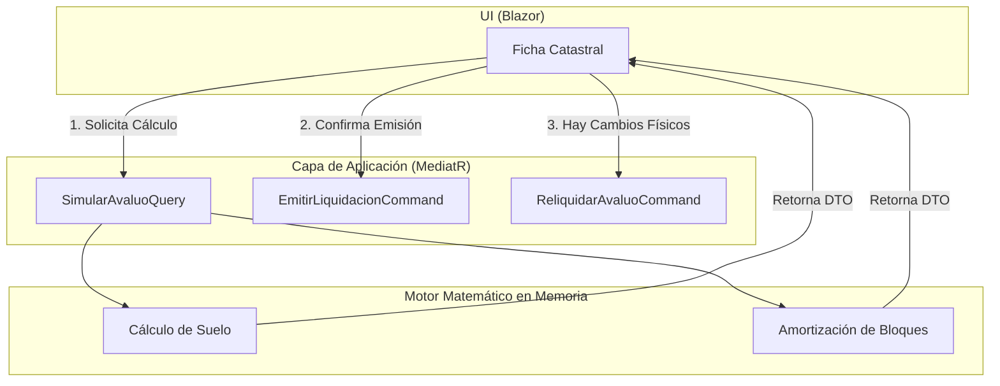
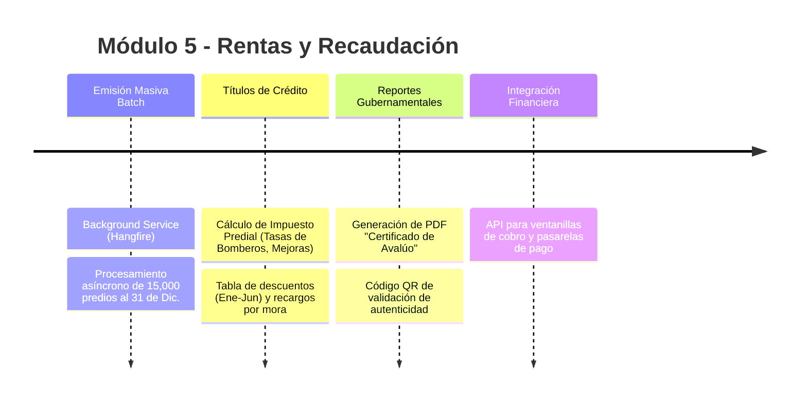

# 💰 Resumen Ejecutivo: Módulo 4 - Motor de Valoración y Liquidación (MVP)
## Sistema de Gestión Catastral (SGC) - GAD Municipal de Antonio Ante

---

> [!IMPORTANT]
> **Documento Oficial de Arquitectura y Funcionalidad**  
> Este módulo implementa el motor matemático-financiero del catastro. Basado en la normativa técnica del MIDUVI y el COOTAD, permite calcular la Base Imponible Comercial de los predios, congelar liquidaciones fiscales (Títulos de Crédito) y gestionar los parámetros económicos anuales.

---

## 📑 Tabla de Contenidos
1. [Dominio y Base de Datos (Parámetros y Liquidaciones)](#1-dominio-y-base-de-datos-parámetros-y-liquidaciones)
2. [Motor Matemático (Capa de Aplicación y CQRS)](#2-motor-matemático-capa-de-aplicación-y-cqrs)
3. [Capa Cliente (Frontend en Blazor WebAssembly)](#3-capa-cliente-frontend-en-blazor-webassembly)
4. [Trazabilidad Legal (Baja y Reliquidación)](#4-trazabilidad-legal-baja-y-reliquidación)
5. [Mejoras Sugeridas para Futuros Sprints (Módulo 5)](#5-mejoras-sugeridas-para-futuros-sprints-módulo-5)

---

## 🧱 1. Dominio y Base de Datos (Parámetros y Liquidaciones)

Se diseñó un esquema relacional histórico que aísla los valores económicos por **Año Fiscal**, garantizando el principio tributario de irretroactividad:
* **Catálogos Económicos:** 
  * `PreciosBaseSuelo` (Por tipo de predio, zona y sector).
  * `CostosReposicion` (Por tipo de estructura constructiva).
  * `FactoresDepreciacion` (Matriz de castigo por edad y estado de conservación).
  * `FactoresAfectacion` (Coeficientes reductores topográficos/geométricos).
* **Entidad LiquidacionPredial:** Almacena el *snapshot* (fotografía congelada) del avalúo en un momento dado, blindando la obligación fiscal contra cambios paramétricos posteriores. Incluye campos de auditoría (`EstadoLiquidacion`, `FechaEmision`, `MotivoAnulacion`).

---

## ⚙️ 2. Motor Matemático (Capa de Aplicación y CQRS)

* **Simulación en Memoria (`SimularAvaluoQuery`):** Algoritmo atómico (Eager Loading) que cruza la realidad física del predio con los parámetros del año solicitado. No muta la base de datos, devuelve un `AvaluoSimuladoDto` con el desglose contable detallado.
* **Emisión Oficial (`EmitirLiquidacionCommand`):** Persiste el resultado de la simulación en la tabla de liquidaciones, bloqueando legalmente el avalúo para ese año fiscal.

---

## 💻 3. Capa Cliente (Frontend en Blazor WebAssembly)

| Componente | Funcionalidad UI/UX |
| :--- | :--- |
| **Panel `ParametrosAvaluos.razor`** | Interfaz administrativa con navegación por *Tabs* para gestionar los 4 catálogos económicos. Implementa un `Select` global de Año Fiscal reactivo, operaciones CRUD completas y cambio de estado *soft-delete* instantáneo sin recarga de página. |
| **Pestaña de Valoración (Ficha Catastral)** | UI Data-Dense que desglosa la contabilidad de la propiedad mediante Tarjetas (Suelo, Construcciones Amortizadas y Base Imponible). |
| **UX de Edición Continua** | Modificaciones físicas en el predio (áreas, bloques) ya no expulsan al usuario de la vista; recargan la página en silencio, actualizan el Modo Lectura y recalculan la simulación de impacto económico en tiempo real. |
| **Sistema de Notificaciones** | Integración de *Toasts* semánticos flotantes (Verde/Éxito, Rojo/Error) y validaciones severas con *SweetAlert2* para proteger acciones destructivas o inmutables. |

---

## ⚖️ 4. Trazabilidad Legal (Baja y Reliquidación)

Para cumplir con las auditorías de la Contraloría, se bloqueó la capacidad de hacer `UPDATE` a un avalúo emitido. 
* Si un técnico modifica los linderos físicos o descubre un bloque no censado en un predio ya liquidado, el Frontend detecta automáticamente la discrepancia matemática (`ExisteDiferenciaConLiquidacionVigente`).
* Se habilita el flujo de **Baja y Sustitución**: Se exige un motivo legal/técnico obligatorio (máx. 500 caracteres), se anula el registro antiguo (cambiando su estado) y se inserta el nuevo cálculo como el vigente.

---

## 🚀 5. Mejoras Sugeridas para Futuros Sprints (Módulo 5)

