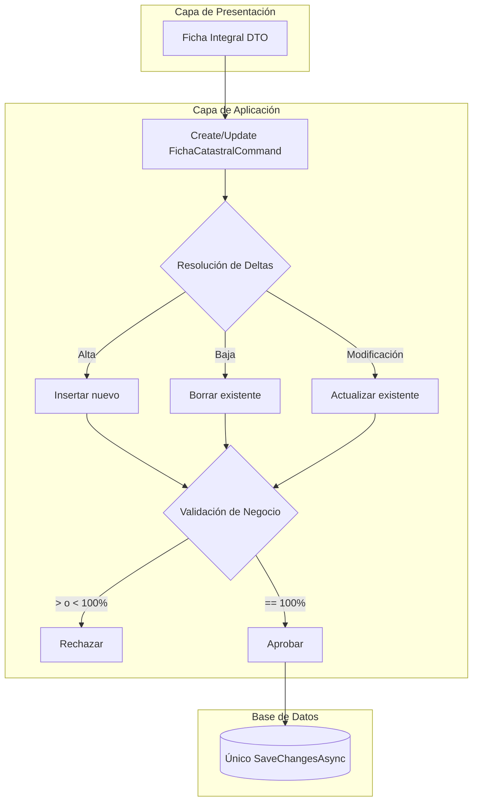
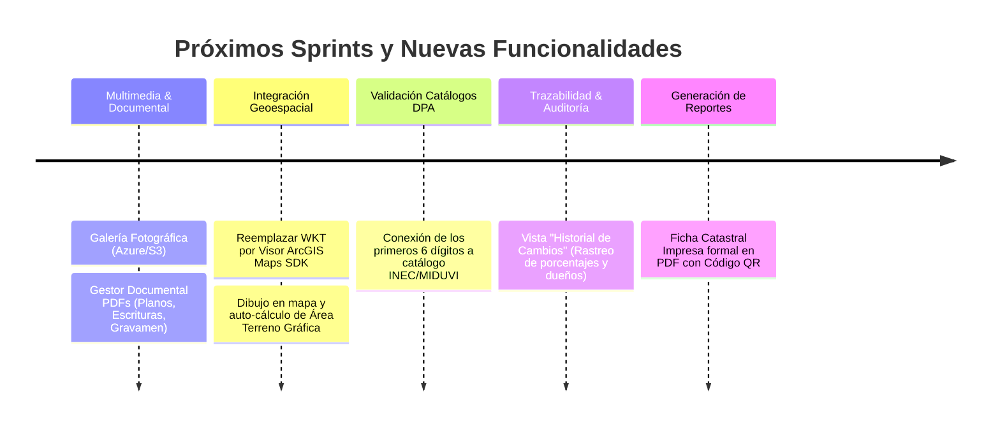

# 🗺️ Resumen Ejecutivo: Módulo 2 - Ficha Catastral Multifinalitaria (Core MVP)
## Sistema de Gestión Catastral (SGC) - GAD Municipal de Antonio Ante

---

> [!IMPORTANT]
> **Documento Oficial de Arquitectura y Funcionalidad**  
> Este módulo establece el motor central del Sistema de Gestión Catastral (SGC), implementando la norma técnica del MIDUVI mediante el patrón de diseño **Arquitectura Limpia** y **Domain-Driven Design (DDD)**.

---

## 📑 Tabla de Contenidos
1. [Capa de Dominio y Base de Datos (Core & Infraestructura)](#1-capa-de-dominio-y-base-de-datos-core--infraestructura)
2. [Capa de Aplicación (Casos de Uso y CQRS)](#2-capa-de-aplicación-casos-de-uso-y-cqrs)
3. [Capa de Presentación (API REST)](#3-capa-de-presentación-api-rest)
4. [Capa Cliente (Frontend en Blazor WebAssembly)](#4-capa-cliente-frontend-en-blazor-webassembly)
5. [Mejoras Sugeridas para Futuros Sprints (Backlog)](#5-mejoras-sugeridas-para-futuros-sprints-backlog)

---

## 🧱 1. Capa de Dominio y Base de Datos (Core & Infraestructura)

| Concepto Técnico | Implementación y Propósito |
| :--- | :--- |
| **Modelo de Agregado (Aggregate Root)** | Se definió a la entidad `Predio` como la raíz del agregado, controlando el ciclo de vida de sus entidades hijas (`Dominio` y `BloqueConstruccion`). |
| **Encapsulamiento Estricto** | Implementación de modelos de dominio ricos con *setters privados*. La instanciación y mutación de datos se realiza exclusivamente a través de métodos de fábrica (`Crear()`) y de actualización (`ActualizarDatosTerreno()`, `Actualizar()`), garantizando que los objetos siempre estén en un estado válido. |
| **Soporte Geoespacial** | Configuración de **NetTopologySuite** en Entity Framework Core para almacenar las coordenadas del lote en la base de datos (campo `PoligonoFisico`). |

---

## ⚙️ 2. Capa de Aplicación (Casos de Uso y CQRS)

* **Comandos Atómicos:** Creación de `CreateFichaCatastralCommand` y `UpdateFichaCatastralCommand` en MediatR. Estos comandos procesan el DTO completo (Ficha Integral) y ejecutan un único `SaveChangesAsync()`, implementando transaccionalidad total (todo o nada).
* **Resolución de Deltas (Edición):** Lógica compleja en el comando de actualización para identificar altas (insert), bajas (delete) y modificaciones (update) en las listas de propietarios y bloques constructivos, basándose en la presencia del `Id`.
* **Validaciones de Negocio Estrictas:** Reglas en FluentValidation que prohíben guardar la ficha si la sumatoria de las alícuotas de los propietarios (`PorcentajePropiedad`) no es exactamente el **100.00%**.

---

## 🌐 3. Capa de Presentación (API REST)

* **Endpoints Centralizados:** Exposición de endpoints centralizados en `PrediosController`:
  * Paginación: `[HttpGet]`
  * Recuperación integral: `[HttpGet("{id}")]`
  * Creación: `[HttpPost]`
  * Actualización: `[HttpPut("{id}")]`
  * Borrado lógico: `[HttpPut("{id}/cambiar-estado")]`
* **Seguridad y Cierre de Vulnerabilidades:** Eliminación de endpoints y comandos fragmentados obsoletos, cerrando vulnerabilidades de inyección de datos fuera del agregado.

---

## 💻 4. Capa Cliente (Frontend en Blazor WebAssembly)

| Componente | Funcionalidad UI/UX |
| :--- | :--- |
| **Dashboard de Gestión** | Grid interactiva con paginación delegada al servidor (server-side), debounce en la búsqueda y filtros combinados (Estado, Clasificación de Suelo). |
| **Componente Super-Modal** | Interfaz dividida en tres pestañas (Datos del Terreno, Dominios, Edificaciones) para reducir la carga cognitiva del digitador. |
| **Segmentación DPA Inteligente**| Widget visual que separa la clave catastral en 10 segmentos para la zona urbana (24 dígitos) y 8 para la rural (19 dígitos), con bloqueo automático de estos identificadores primarios (PK) durante el modo edición. |
| **Edición In-line** | Sistema de variables en memoria que permite cargar un propietario o bloque existente en el formulario superior, modificar sus atributos (ej. estado de conservación, porcentaje) y devolverlo a la tabla sin necesidad de eliminarlo y recrearlo. |
| **UX Reactiva** | Barreras visuales e indicadores que bloquean el botón principal hasta que las tres pestañas cumplan con las directrices de integridad de datos. |

---

## 🚀 5. Mejoras Sugeridas para Futuros Sprints (Backlog)

### Detalle de Tareas:

* **Multimedia y Evidencia Documental:**
  * **Galería Fotográfica:** Añadir una cuarta pestaña en el modal para cargar imágenes del predio (fachada, linderos) con almacenamiento en la nube (Azure Blob Storage o AWS S3).
  * **Gestor Documental:** Permitir la carga de documentos PDF como el levantamiento planimétrico, las escrituras notariadas o el certificado de gravamen para respaldar la información de la pestaña de Dominios.

* **Integración Geoespacial Bidireccional (Módulo 3):**
  * Reemplazar el campo de texto Polígono Espacial (Formato WKT OGC) por un visor de mapa integrado (**ArcGIS Maps SDK for JavaScript**).
  * Permitir que el usuario dibuje el polígono directamente en el mapa y que Blazor extraiga automáticamente el WKT y el cálculo matemático del *Área Terreno Gráfica* para compararlo con el área de escrituras.

* **Validación Avanzada de Catálogos (DPA):**
  * Conectar los primeros 6 dígitos de la clave DPA (Provincia, Cantón, Parroquia) a un catálogo real y bloqueado del INEC/MIDUVI para evitar errores de digitación (ej. Imbabura = 10, Antonio Ante = 02).

* **Trazabilidad y Auditoría de Datos:**
  * Implementar una vista de "Historial de Cambios" donde se pueda consultar quién modificó la ficha, cuándo se realizó el traspaso de un dominio a un nuevo dueño y qué valor tenía el porcentaje anterior.

* **Generación de Reportes:**
  * Diseñar y programar un botón en la tabla principal que exporte la "Ficha Catastral Impresa" en formato PDF formal, incluyendo el código QR de validación municipal y el plano extraído del GIS.