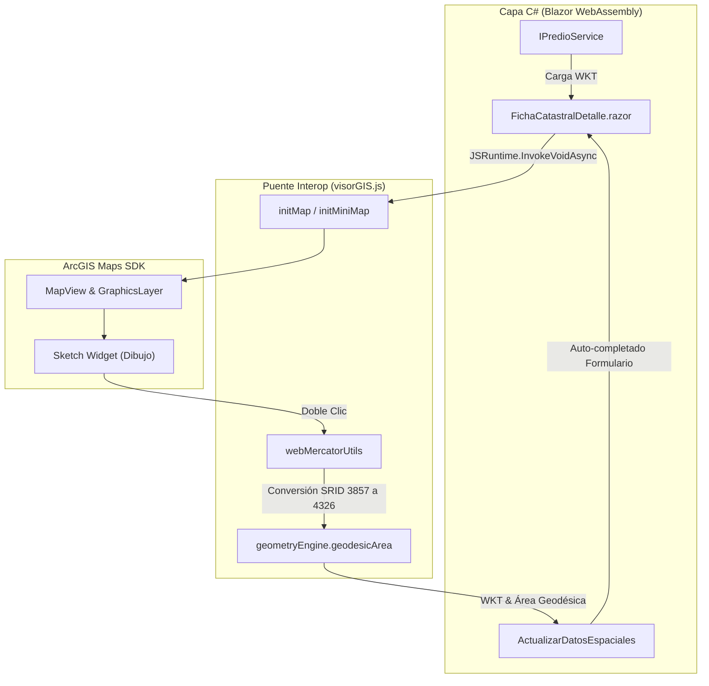
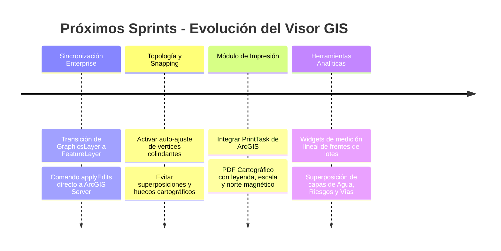

# 🗺️ Resumen Ejecutivo: Módulo 3 - Visor Geoespacial (ArcGIS) (MVP)
## Sistema de Gestión Catastral (SGC) - GAD Municipal de Antonio Ante

---

> [!IMPORTANT]
> **Documento Oficial de Arquitectura y Funcionalidad**  
> Este módulo dota al Sistema de Gestión Catastral de inteligencia espacial. Implementa una **Estrategia de Renderizado Híbrido** que permite la digitalización, visualización y auto-cálculo geométrico utilizando el **ArcGIS Maps SDK for JavaScript** integrado nativamente con Blazor mediante JSInterop.

---

## 📑 Tabla de Contenidos
1. [Capa de Dominio y Base de Datos (Core & Infraestructura)](#1-capa-de-dominio-y-base-de-datos-core--infraestructura)
2. [Motor GIS e Interoperabilidad (JSInterop)](#2-motor-gis-e-interoperabilidad-jsinterop)
3. [Capa de Presentación (API REST)](#3-capa-de-presentación-api-rest)
4. [Capa Cliente (Frontend en Blazor WebAssembly)](#4-capa-cliente-frontend-en-blazor-webassembly)
5. [Mejoras Sugeridas para Futuros Sprints (Backlog)](#5-mejoras-sugeridas-para-futuros-sprints-backlog)

---

## 🧱 1. Capa de Dominio y Base de Datos (Core & Infraestructura)

| Concepto Técnico | Implementación y Propósito |
| :--- | :--- |
| **Inyección de Semilla Geoespacial (Seeder)** | Implementación de `CatastroSeeder` para poblar la base de datos con predios reales del centro de Atuntaqui. Utiliza coordenadas en formato WKT (`POLYGON`) bajo el sistema de referencia espacial WGS84 (SRID 4326). |
| **Endpoint Cartográfico Optimizado** | Creación del caso de uso `GetPrediosEspacialesQuery` que extrae exclusivamente los datos necesarios para el mapa (Clave, Polígono, Área, Propietario Principal), reduciendo el peso del *payload* mediante proyección directa en EF Core. |
| **Integración NetTopologySuite (NTS)** | Configuración de NTS para el manejo, conversión y validación nativa de geometrías espaciales dentro de la base de datos transaccional SQL. |

---

## ⚙️ 2. Motor GIS e Interoperabilidad (JSInterop)

- **Arquitectura Sin Dependencias (No Wrappers):** Creación del motor `visorGIS.js` que interactúa nativamente con el SDK oficial de Esri, invocado desde C# de forma asíncrona.
- **Parser WKT a JSON Esri:** Conversión en tiempo real mediante `Wicket.js` de las cadenas WKT (`POLYGON((...))`) provenientes del backend hacia anillos de coordenadas JSON compatibles con los `GraphicsLayer` de Esri.
- **Transformación de Proyecciones:** Integración del módulo `webMercatorUtils` para interceptar los polígonos dibujados (Web Mercator SRID 3857) y transformarlos obligatoriamente a coordenadas geográficas (Lat/Lon SRID 4326) antes de generar el WKT.
- **Auto-Cálculo Geodésico:** Uso de `geometryEngine.geodesicArea` para obtener el área gráfica exacta en metros cuadrados en el momento en que el digitador cierra el polígono, mitigando el error humano.

---

## 🌐 3. Capa de Presentación (API REST)

- **Endpoint Cartográfico Dedicado:** Exposición en `PrediosController` de la ruta especializada para el visor:
  - Capa Espacial Ligera: `[HttpGet("espaciales")]` (`GetPrediosEspaciales`) con soporte de filtrado por criterio de búsqueda y clasificación (`TipoPredio`).
- **Contrato en Cliente:** Extensión de `IPredioService` con el método `ObtenerEspacialesAsync()` para alimentar de forma rápida y desacoplada el lienzo cartográfico.

---

## 💻 4. Capa Cliente (Frontend en Blazor WebAssembly)

| Componente | Funcionalidad UI/UX |
| :--- | :--- |
| **Visor Cartográfico General (`VisorCatastral.razor`)** | Pantalla dedicada con mapa a pantalla completa, controles flotantes para búsqueda, filtrado por uso de suelo y popups nativos de DOM que usan *Deep Linking* para redirigir al expediente predial. |
| **Rediseño del Expediente Predial (Data-Dense UI)** | Desacoplamiento del antiguo Super-Modal hacia una página dedicada (`/catastro/predios/{Id}`). Interfaz compacta orientada a transacciones, con tablas estructuradas para los dígitos de la clave DPA y cuadros comparativos de áreas. |
| **Mini-Visor y Herramienta Sketch** | Modal flotante dentro de la Ficha Catastral que carga una vista satelital (`hybrid`) equipada con el widget `Sketch` de Esri para el trazado geoespacial de lotes nuevos o modificación de linderos. |
| **Control de Estados y Validaciones DPA** | Enrutamiento por parámetros (`?modo=ver` vs `?modo=editar`) y navegación con `history.back`. Validación estricta y reactiva de la longitud de la Clave DPA (19 o 24 dígitos) bloqueando guardados inconsistentes. |

---

## 🚀 5. Mejoras Sugeridas para Futuros Sprints (Backlog)

### Detalle de Tareas:

- **Sincronización con Feature Server (Enterprise GIS):**
  - **Mejora:** Cuando el GAD habilite su servidor ArcGIS Enterprise, reemplazar el `GraphicsLayer` simulado por un `FeatureLayer` real. Las ediciones en Blazor enviarán un comando `applyEdits` directamente al servidor de Esri.
- **Topología y Ajuste Geométrico (Snapping):**
  - **Mejora:** Habilitar las opciones de *Snapping* en el widget de dibujo para que el cursor actúe como un imán hacia los vértices y aristas de los predios vecinos al digitalizar, evitando superposiciones o huecos cartográficos (*slivers*).
- **Módulo de Impresión Cartográfica:**
  - **Mejora:** Integrar el `PrintTask` de ArcGIS para generar un archivo PDF que contenga el croquis del predio, la leyenda, escala gráfica, norte magnético y sello municipal.
- **Herramientas Analíticas y de Medición:**
  - **Mejora:** Añadir *widgets* de medición lineal para calcular los frentes de los lotes y permitir encender/apagar capas municipales superpuestas (redes de agua potable, alcantarillado, zonificación de riesgos).